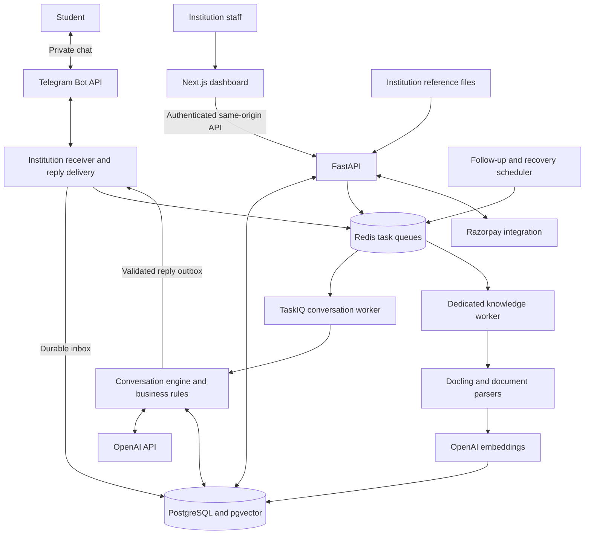
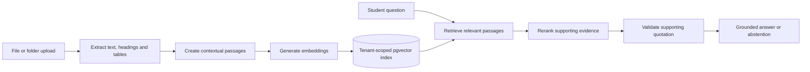

# AdmitFlow

**Personalised course guidance for students. One admissions workspace for institutions.**

AdmitFlow helps students explore courses through a natural Telegram conversation. It learns
from their interests, educational background and goals, introduces relevant options they may
not know about, and answers questions using institution reference material. Admissions teams
see the conversation, shared details and next steps in an authenticated web dashboard.

[Features](#features) · [Architecture](#architecture) · [AI workflow](#how-admitflow-uses-ai) ·
[Tech stack](#tech-stack) · [Getting started](#getting-started) · [Documentation](#documentation)

## The problem

Choosing a course often starts with an incomplete picture. A student may know only familiar
degree names, feel unsure about their interests, or struggle to understand entry requirements.
Institution websites and documents contain useful information, but students still need help
connecting it to their own situation.

Admissions teams face the other side of that conversation: repeated questions, scattered
inquiries and students who have to explain their background again when staff take over.

## The idea

Give each student a conversation that helps them make an informed choice, while retaining
useful context for the institution.

AdmitFlow adapts its next question to what the student has already shared. It accepts free
text and uses contextual options when they make answering easier. A student with a clear
choice can move ahead; an uncertain student can explore relevant alternatives at their pace.
If the catalogue does not offer a suitable course, the assistant explains the gap instead of
pushing an unrelated option.

The intended benefit is less repetitive information collection and more useful admissions
conversations. Customer demand, conversion gains and time savings have not yet been measured.

## Features

### For students

- **Adaptive course guidance:** explore interests, background, study goals and practical
  constraints without a fixed interview or compulsory quiz.
- **Relevant course discovery:** compare familiar and less familiar options using the
  institution's catalogue and the student's explicit preferences.
- **Context and corrections:** update earlier answers without restarting the conversation.
- **Grounded answers:** ask about institution information drawn from indexed documents;
  missing supporting evidence leads to an honest fallback.
- **Application support:** for configured admissions offerings, reuse supplied details,
  collect missing information and require review before submission.
- **Clear controls:** typing feedback, fresh conversation reset, optional deeper exploration
  and staff help when requested or necessary.

### For institutions

- **Admissions workspace:** inspect inquiries, transcripts, guidance evidence and application
  progress in one authenticated dashboard.
- **Knowledge library:** upload files or folders, track indexing, retry failed uploads and
  search reference passages. Supports digital PDF, DOCX and text, including Markdown/CSV.
- **Catalogue management:** manage courses, batches, eligibility rules, application fees and
  discounts. Published reference records remain separate from admissions offerings.
- **Staff collaboration:** take over a conversation, review co-pilot drafts and explicitly
  resume automation when the staff interaction ends.
- **Applications and payment operations:** review applications, inspect payment states and
  reconcile supported provider records through controlled actions.
- **Follow-ups and reporting:** consent-aware reminders, analytics, CSV/Excel exports,
  notifications and signed outbound webhooks.
- **Administration and privacy:** staff roles, tenant-scoped access, audit records, erasure
  and retention controls.

## How a conversation works

1. A student starts a private conversation with the institution's Telegram bot.
2. The assistant uses what they share to decide whether to clarify, explore, compare or
   answer a question. It does not require the same sequence from every student.
3. Course suggestions connect explicit interests and background to catalogue information.
   Code checks configured academic rules separately from interest exploration.
4. Questions about the institution use retrieved reference material. The assistant avoids
   inventing unavailable courses, prices, admission decisions or seat reservations.
5. For an actual admissions offering, the student can continue through eligibility and
   application review. Staff receive the saved context when intervention is needed.

The current adaptive guidance experience uses **English**. Its research-informed approach
uses CIP/CASVE decision support, tentative activity-interest themes and OARS listening
principles. Optional deeper exploration is **not a validated psychometric or aptitude test**.
See the [research and implementation mapping](docs/engineering/ADAPTIVE_GUIDANCE_RESEARCH.md).

## Architecture



The receiver binds a bot to an institution and persists accepted updates with polling
checkpoints. Workers process the saved conversation and commit state with a reply outbox.
Delivery tracks sent, failed and uncertain outcomes rather than blindly repeating ambiguous
sends. A separate serial knowledge worker keeps document parsing away from interactive
conversation processing.

The dashboard proxies requests through the same origin to FastAPI. PostgreSQL stores
institution-scoped records and vector embeddings; Redis supports background work and shared
operational controls.

## How AdmitFlow uses AI

| Responsibility | Approach |
| --- | --- |
| Understand a message | OpenAI produces typed decisions and extracts explicitly stated facts and preferences. |
| Guide a student | A bounded planning step uses conversation evidence and refreshed catalogue checks to choose a useful response. |
| Find reference material | OpenAI embeddings support tenant- and course-scoped semantic retrieval in pgvector. |
| Rank and answer | OpenAI reranks eligible passages and selects supporting quotations; relevance and quotation checks constrain the answer. |
| Make consequential changes | Application code controls eligibility, fees, access, selections and application/payment state. |

OpenAI is the active hosted AI provider. Model roles are configurable in
[backend/.env.example](backend/.env.example); the current defaults use `gpt-4.1-mini` and
`text-embedding-3-small`. No model fine-tuning or additional hosted inference service is
required. Retrieved documents and student messages are treated as untrusted input.

### Knowledge ingestion and retrieval



Digital PDF parsing uses offline CPU Docling layout/table models. DOCX and text extraction
preserve useful structure. OCR is outside this version, so scanned pages need a searchable
replacement. Original uploaded files are encrypted; extracted reference text is stored in the
institution-scoped database. Sources remain available internally and in staff search without
adding document filenames to every student reply.

## Tech stack

| Layer | Technologies and tools | Purpose |
| --- | --- | --- |
| Student channel | Telegram Bot API | Private chat, contextual buttons and typing feedback |
| Web dashboard | Next.js, React, TypeScript | Staff workspace and same-origin API proxy |
| API and validation | Python 3.12+, FastAPI, Pydantic | Authenticated endpoints and typed contracts |
| Conversation | Async Python conversation engine, OpenAI API | Adaptive guidance, memory and bounded decisions |
| Data and retrieval | PostgreSQL, pgvector, SQLAlchemy, Alembic | Tenant records, vector search and migrations |
| Background processing | Redis, TaskIQ | Conversation, document and follow-up jobs |
| Document understanding | Docling, PDF/DOCX/text parsers | Offline layout/table extraction and structured ingestion |
| Payments | Razorpay | Test credential provisioning, payment links and signed webhook handling |
| Public reference discovery | SerpAPI and official source pages | Discover JAIN Kochi programme information for the local reference catalogue |
| Quality checks | pytest, Ruff, strict mypy, TypeScript, Playwright | Logic, database, typing and browser verification |
| Local packaging and CI | uv, npm, Docker Compose, GitHub Actions | Reproducible environments and protected-branch checks |

Legacy WhatsApp compatibility remains in source with the feature disabled by default.
Telegram is the active product channel. Optional observability providers are not prerequisites
for the local stack.

## Getting started

### Prerequisites

- Python **3.12+** and `uv`.
- A supported Node.js release and `npm` for the dashboard; CI uses Node 22 and the container build uses Node 24.
- Docker with Compose for the packaged stack and disposable database integration tests.
- An OpenAI API key for live guidance, embeddings and reranking.
- An institution-owned Telegram bot token for a live student conversation.

### Option 1: Isolated Docker Compose workspace

This starts a separate local workspace with synthetic sample courses and a generated staff
account. It does not copy the owner's active database, JAIN reference import or credentials.

```bash
git clone https://github.com/Shan091/admitflow.git
cd admitflow/backend
uv sync --frozen
uv run python -m src.scripts.configure_compose
cd ..
```

The configuration command creates a private root `.env` and refuses to overwrite an existing
file. Add your own `OPENAI_API_KEY` to that file before starting model-dependent features.
Then run from the repository root:

```bash
docker compose config --quiet
docker compose up --build -d --wait
docker compose cp bootstrap:/run/admitflow/.demo-credentials.json backend/.demo-compose-credentials.json
```

| Service | Local address |
| --- | --- |
| Staff dashboard | `http://127.0.0.1:13000` |
| API documentation | `http://127.0.0.1:18000/docs` |
| API readiness | `http://127.0.0.1:18000/ready` |

Sign in using the institution code, email and password in the generated private credential
file. Keep it out of Git and shared screenshots.

To enable Telegram in this isolated workspace, configure a **separate test bot** in the root
`.env`, then run:

```bash
docker compose --profile telegram up -d receiver
```

Only one receiver should poll a bot. Follow the [Compose runbook](docs/engineering/COMPOSE_RUNTIME.md)
for configuration, verification, restart and recovery details.

### Option 2: Native development

Use [the native runtime guide](docs/engineering/LOCAL_RUNTIME.md) for PostgreSQL/Redis setup,
private `backend/.env` configuration, migrations, institution provisioning and all required
processes. The native dashboard uses port **3000**, and the API uses port **8000**.

The main entry points, run in separate terminals, are:

```bash
# From backend/, after configuring data services and applying migrations:
uv run uvicorn src.main:app --host 127.0.0.1 --port 8000
uv run taskiq worker src.tasks.broker:broker src.tasks.telegram src.tasks.followups src.tasks.integrations --workers 1
uv run taskiq worker src.tasks.knowledge:broker src.tasks.knowledge --workers 1 --max-async-tasks 1
uv run python -m src.telegram.receiver --institution-code demo
uv run python -m src.scripts.scheduler

# From frontend/:
npm ci
npm run dev
```

Prepare document models before native PDF ingestion using
`uv run python -m src.scripts.prepare_document_models` from `backend/`.
See [backend setup](backend/README.md) for manual institution/admin provisioning.

### Configuration

| Setting | Used for |
| --- | --- |
| `DATABASE_URL`, `REDIS_URL` | Database and background services |
| `PII_ENCRYPTION_KEY`, `PHONE_HASH_KEY` | Application encryption and identifier lookup/signing |
| `OPENAI_API_KEY` | Live model requests and embeddings |
| `TELEGRAM_BOT_TOKEN`, `TELEGRAM_INSTITUTION_CODE` | Institution bot binding |
| `RAZORPAY_KEY_ID`, `RAZORPAY_KEY_SECRET`, `RAZORPAY_WEBHOOK_SECRET` | Optional institution payment integration |
| `PAYMENTS_LIVE_ENABLED` | Explicit live-payment guard; keep `false` for local testing |

Use [the environment template](backend/.env.example) for defaults and optional settings.
The Compose root `.env` and native `backend/.env` are separate configurations. Never commit
secrets or expose them in the frontend. Retain encryption keys with database backups.

## Student commands

| Command | Purpose |
| --- | --- |
| `/start` | Start an English admissions conversation |
| `/guide` | Resume course guidance |
| `/courses` | Browse catalogue options |
| `/assessment` | Opt into deeper exploratory guidance |
| `/apply` | Start or resume an application for a configured admissions offering |
| `/pause` | Keep an unfinished application draft for later |
| `/reset` | Confirm a fresh conversational context |
| `/human` | Explicitly request staff help |
| `/followups`, `/stop` | Manage reminder consent |

A reset excludes earlier chat from future model context and clears unfinished exploration or
a draft. It preserves institutional history, submitted applications/payments, reminder choices
and active staff requests. It is not a data-erasure command.

## Verification and current scope

The latest catalogue release passed:

- **313 default backend tests**, lint/format and strict typing across **127 source files**.
- **121 PostgreSQL cases**, with two Redis-specific cases skipped in that run, plus six
  final focused reset/reference/application/payment cases.
- Frontend lint/build and an authenticated reference-catalogue check at desktop and mobile widths.
- Three live synthetic OpenAI/RAG checks against the imported catalogue. Separate earlier
  handset checks confirmed Telegram replies, a staff reply and an uploaded-PDF answer.

These are bounded implementation checks, not measured student outcomes or a production
certification. The [release record](docs/event/JAIN_KOCHI_RELEASE.json),
[handset evidence](docs/event/LIVE_HANDSET_RESULTS.json) and
[task list](tasks/todo.md) retain the details and limitations.

Run the standard checks:

```bash
# From backend/:
bash scripts/verify.sh
uv run pytest -m integration

# From frontend/:
npm ci
npm run lint
npm run build
```

The backend default gate uses isolated test configuration. Integration tests require Docker;
live browser checks additionally require the configured local application. See the
[testing guide](docs/engineering/testing.md) before running provider-dependent evaluations.

### Current reference catalogue

The owner's local workspace contains **64 published JAIN Kochi programme options** and
**65 indexed official-source documents**. This is an independent public-information
example, with [source provenance and boundaries](docs/decisions/ADR-016-public-reference-catalogue.md).
Public listings do not verify current fees, intakes, seats or admission approval. Reference
records support exploration and cannot accept university applications or payments here.
The snapshot is in [backend/data/jain-kochi/catalogue.json](backend/data/jain-kochi/catalogue.json).

Razorpay test credentials have passed a read-only provider check and are stored encrypted in
the local institution configuration. Actual test-card and public webhook validation remain
open. Live payments remain disabled, and public production deployment has not been performed.

## Security and operational boundaries

- Institution-scoped queries and database constraints separate tenant records.
- Staff authentication, roles and scoped sessions control dashboard/API access.
- Sensitive identifiers, conversation payloads and original upload bytes use application-layer
  encryption. Knowledge passages remain institution-scoped reference text.
- Signed controls, durable inbox/outbox records and audit logs protect state transitions.
- Consent and configured office hours govern automated follow-ups.
- Prices and eligibility come from configured institutional data, with explicit application
  review. Meeting an entry rule does not grant admission or reserve a seat.
- Missing evidence and uncertain provider outcomes remain visible rather than becoming
  invented answers or automatic retries.

See [security and production readiness](docs/engineering/security-and-production.md) for
hosting requirements. Production use also needs approved institution material, HTTPS,
operational monitoring, backups and recovery validation.

## Repository structure

```text
admitflow/
├── backend/
│   ├── src/
│   │   ├── engine/       # Conversation, guidance and application flows
│   │   ├── knowledge/    # Parsing, indexing, retrieval and reranking
│   │   ├── telegram/     # Institution bot receiver, identity and delivery
│   │   ├── staff/        # Authenticated workspace APIs
│   │   ├── payments/     # Provider integration and webhook processing
│   │   ├── tasks/        # Background jobs and recovery
│   │   ├── db/           # Tenant models and persistence
│   │   └── scripts/      # Provisioning and bounded validation tools
│   ├── migrations/      # Alembic schema migrations
│   ├── data/            # Sourced public reference snapshot
│   └── tests/           # Unit and integration checks
├── frontend/
│   ├── app/             # Next.js staff workspace
│   └── tests/           # Playwright browser checks
├── docs/                # Engineering guides, decisions and event evidence
├── tasks/               # Existing implementation plan and completion records
├── docker-compose.yml   # Isolated local full-stack runtime
└── SPEC.md              # Product behavior and constraints
```

## Documentation

| Resource | Contents |
| --- | --- |
| [Product specification](SPEC.md) | Expected behavior and scope |
| [Implementation plan](tasks/plan.md) and [task list](tasks/todo.md) | Work breakdown and verified progress |
| [Architecture decisions](docs/decisions/) | Provider, conversation, retrieval and safety decisions |
| [Backend guide](backend/README.md) | Configuration, endpoints and provisioning |
| [Document ingestion](docs/engineering/DOCUMENT_INGESTION.md) | Parsing, indexing and worker operations |
| [Guidance research](docs/engineering/ADAPTIVE_GUIDANCE_RESEARCH.md) | Research-to-behavior mapping and assessment limits |
| [AI Impact Statement](docs/event/AI_IMPACT_STATEMENT.md) | AI use, safeguards and intended impact |
| [Data/model provenance](docs/event/DATA_PROVENANCE.md) | Source material and upstream terms |
| [Prior-work disclosure](docs/event/PRIOR_WORK_DISCLOSURE.md) | Existing foundation and subsequent implementation |

## Contributing

Start with [AGENTS.md](AGENTS.md) and the
[development lifecycle](docs/engineering/development-lifecycle.md). Use a feature branch,
add meaningful checks for behavior changes, pass the quality gate and open a pull request.
Changes to authentication, tenant scope, student data or payments need particular review.
Use GitHub issues to report reproducible problems without credentials or applicant data.

## Owner and license

**Shan** is the owner and solo contributor submitting AdmitFlow for AIBoomi Startup Weekend.
The project continues an existing foundation; the repository preserves its
[prior-work disclosure](docs/event/PRIOR_WORK_DISCLOSURE.md).

Project source is available under the [MIT License](LICENSE). Dependencies, model assets,
public reference material and event documents retain their respective terms.
