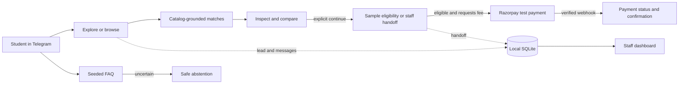
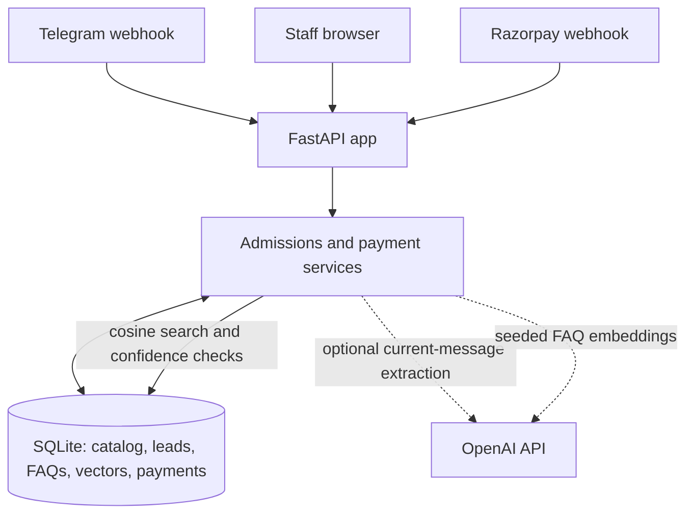

<div align="center">
  
  <h1>AdmitFlow</h1>
  <p><strong>Course guidance that listens before it recommends.</strong></p>
  <p>A Telegram admissions assistant and staff dashboard, built for the DevDay Exchange Community Hackathon: Kochi.</p>
  <p>
    <a href="https://github.com/Shan091/admitflow/actions/workflows/ci.yml"></a>
    
    
  </p>
</div>

---

> [!IMPORTANT]
> **Hackathon demo only.** The institution, courses, requirements, and fees are fictional sample
> data. Recommendations and eligibility are not real admission decisions. Use fictional inputs
> only: Telegram identifiers and messages are stored locally, and typed text is sent to OpenAI
> while AI processing is enabled. The bot explains this at `/start`; users can switch AI processing
> off and continue with buttons.

## What it does

AdmitFlow helps prospective learners explore courses offered by a fictional Kerala institution.
It remembers stated interests, explains why sample courses match, and gives staff a small view of
leads and handoffs.

| Learner experience | Staff and system |
| --- | --- |
| Explore by known course, field, interests, or browsing | Authenticated dashboard for leads, attributed facts, and handoffs |
| Get up to three catalog-grounded course matches | SQLite persistence for conversations and demo records |
| Inspect sample requirements, study options, support, and fees before continuing | Code-owned undergraduate sample eligibility and fee values |
| Ask seeded FAQs; uncertain or unavailable retrieval abstains | OpenAI embeddings with local SQLite storage and NumPy cosine search |
| Optionally continue to a Razorpay **test-mode** application-fee link | Payment status changes only after a verified Razorpay webhook |

### Demo flow



### How the boundaries work



OpenAI extraction receives the current message and fictional catalog vocabulary, not the learner's
chat ID, name, or conversation transcript. Python owns recommendations, eligibility, and prices;
OpenAI does not decide them. FAQ retrieval searches the seeded local corpus and fails closed when
the result is weak, ambiguous, or unavailable.

## Run it locally

### Requirements

- Python 3.12
- [`uv`](https://docs.astral.sh/uv/)
- Staff username, password, and session secret for dashboard access
- Optional: Telegram bot credentials, OpenAI API key, and Razorpay **test-mode** credentials

### Install and start

```powershell
uv sync --python 3.12
if (-not (Test-Path .env)) { Copy-Item .env.example .env }
```

This leaves an existing `.env` untouched. Edit `.env` locally. Set strong demo values for
`STAFF_USERNAME`, `STAFF_PASSWORD`, and
`STAFF_SESSION_SECRET`. Never commit `.env` or paste its secrets into issues or chat. Then start
the app:

```powershell
uv run uvicorn admitflow.main:app --reload
```

- Public landing page: <http://127.0.0.1:8000/welcome>
- Staff login/dashboard: <http://127.0.0.1:8000/>
- Health check: <http://127.0.0.1:8000/health>

Without Telegram credentials, the local dashboard and tests can still run. Without an OpenAI key,
free-text AI discovery and FAQ retrieval remain unavailable; button-based exploration still works.
Payments remain disabled unless all Razorpay test credentials are configured.

### Configuration at a glance

| Variables | Needed for | Notes |
| --- | --- | --- |
| `STAFF_USERNAME`, `STAFF_PASSWORD`, `STAFF_SESSION_SECRET` | Staff dashboard | Required; keep local and use non-default demo values. |
| `TELEGRAM_BOT_TOKEN`, `TELEGRAM_WEBHOOK_SECRET` | Telegram bot | Both are needed for the authenticated webhook. |
| `OPENAI_API_KEY` | Free-text discovery and FAQ retrieval | Optional; API usage can incur charges. |
| `RAZORPAY_KEY_ID`, `RAZORPAY_KEY_SECRET`, `RAZORPAY_WEBHOOK_SECRET` | Demo payments | Optional; test-mode keys only, with key ID starting `rzp_test_`. |
| `DATABASE_PATH` | SQLite location | Defaults to `data/admitflow.sqlite3`. |

See [`.env.example`](.env.example) for the full list, including model and retrieval settings.

<details>
<summary><strong>Connect Telegram</strong></summary>

Telegram webhooks require a public HTTPS URL. Set `TELEGRAM_BOT_TOKEN` and
`TELEGRAM_WEBHOOK_SECRET` in `.env`, run the app on a public HTTPS host or tunnel, then register
the hook with the helper (it reads secrets from `.env` and does not print them):

```powershell
uv run python scripts/manage_telegram_webhook.py https://YOUR-PUBLIC-HOST
```

The webhook endpoint is `/api/v1/webhooks/telegram`. To remove the hook:

```powershell
uv run python scripts/manage_telegram_webhook.py --delete
```

Telegram does not deliver webhooks while `getUpdates` polling is active; this project uses webhook
mode only. The helper checks Telegram's reported webhook URL after registration.

</details>

<details>
<summary><strong>Enable Razorpay test payments</strong></summary>

Configure `RAZORPAY_KEY_ID` (must begin with `rzp_test_`), `RAZORPAY_KEY_SECRET`, and
`RAZORPAY_WEBHOOK_SECRET`. In the Razorpay test dashboard, register
`POST /api/v1/webhooks/razorpay` for `payment_link.paid`. Local webhook delivery also needs a
public HTTPS tunnel.

Only an eligible demo applicant who explicitly continues receives a link. The server supplies the
sample fee; a browser redirect cannot mark payment paid. A valid signed webhook updates local status.
Do not use live keys. Automated payment tests use fakes and do not contact Razorpay.

</details>

## Verify and evaluate

Run the same local quality gate as CI before committing:

```bash
bash scripts/verify.sh
```

It runs Ruff lint/format checks, strict mypy, and pytest. Automated tests use fake Telegram updates,
fake embeddings, and temporary databases; they do not call Telegram or OpenAI or spend API credits.
CI runs on pushes and pull requests, and each result applies to its exact commit.

To evaluate the seeded FAQ corpus with the live embedding API, set `OPENAI_API_KEY` and run:

```bash
uv run python scripts/evaluate_faq_retrieval.py
```

This sends only 27 fixed fictional query variants to OpenAI, checks expected matches and refusals,
and reports token usage. API usage is billable; applicant messages are never read by the evaluator.

## Demo walkthrough

1. Register the Telegram webhook and send `/start` to the bot.
2. Read the demo-data and OpenAI notice. Explore by naming a course, activity, interest, goal, or
   study level—or choose a button. Turn AI processing off to keep exploring with buttons only.
3. Review the matches, inspect a course's sample details, then compare again or explicitly continue.
4. Try a seeded FAQ; uncertain or unavailable retrieval should produce an abstention.
5. Sign into the staff dashboard to review the lead and any handoff. Staff can delete one lead or
   reset all local demo records; fictional courses and FAQs remain seeded.
6. With Razorpay test credentials configured, complete the sample eligibility path, request the
   demo fee link, and deliver the signed test webhook.

No live staff contact, response time, or automatic course access is configured. Payment
confirmation means the demo dashboard records a verified paid status; it is not enrollment.

## Scope and limitations

- Fictional single-institution catalog and seeded FAQs; no general document ingestion.
- Sample undergraduate eligibility is code-checked. Other education levels go to staff for
  eligibility confirmation until verified course-specific rules exist.
- English, Malayalam, Hindi, and Hinglish can be selected, but most bot copy is still English;
  translations need fluent-speaker review.
- One environment-configured staff account; no staff roles or production identity provider.
- Local demo reset does not erase records held by Telegram or Razorpay. Automatic retention expiry,
  production privacy review, live payments, refunds, uploads, and WhatsApp are out of scope.

## Project map

| Path | What you'll find |
| --- | --- |
| [`SPEC.md`](SPEC.md) | Mission, hackathon capability map, success criteria, roadmap |
| [`docs/DECISIONS.md`](docs/DECISIONS.md) | Product and architecture decisions |
| [`tasks/todo.md`](tasks/todo.md) | Implementation checklist and remaining work |
| [`tasks/features/`](tasks/features/) | Feature briefs and acceptance criteria |
| [`docs/BUILD_CYCLE.md`](docs/BUILD_CYCLE.md) | Feature delivery and verification loop |
| [`SUBMISSION.md`](SUBMISSION.md) | Hackathon submission details and verified checks |
| [`CHANGELOG.md`](CHANGELOG.md) · [`AI_USAGE.md`](AI_USAGE.md) | Delivery history and AI-assisted work log |

Questions about what is complete? Start with the checklist. For setup or demo status, see the
[submission notes](SUBMISSION.md).
