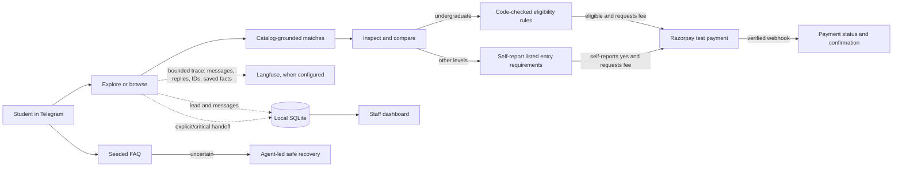
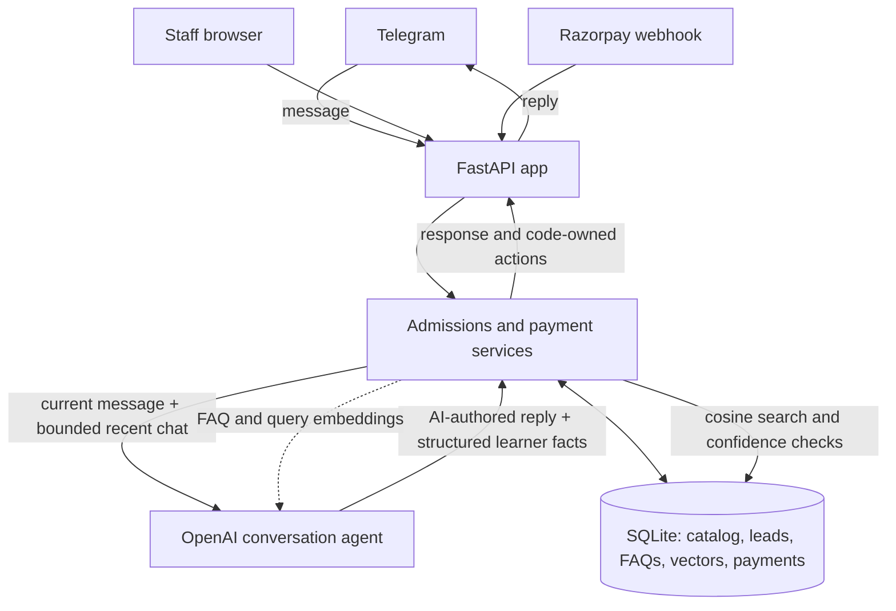

<div align="center">
  
  <h1>AdmitFlow</h1>
  <p><strong>Course guidance that listens before it recommends.</strong></p>
  <p>A Telegram admissions assistant and staff dashboard, built for the DevDay Exchange Community Hackathon: Kochi.</p>
  <p>
    <a href="https://github.com/Shan091/admitflow/actions/workflows/ci.yml"></a>
    
    
  </p>
</div>

---

> [!IMPORTANT]
> **Hackathon demo.** Course details, entry requirements, and fees are illustrative; AdmitFlow does
> not submit an application or make admission decisions. Payments use test mode. Use demo inputs
> only: Telegram identifiers and messages are stored locally. While AI processing is enabled,
> typed text and up to eight recent chat messages plus saved course preferences may be sent to
> OpenAI. Telegram IDs and usernames are excluded from model context. The bot explains this at
> `/start`; users can switch AI processing off and continue with buttons. If Langfuse is enabled,
> inbound/reply text, Telegram user/chat IDs, and saved learner facts are also sent to Langfuse for
> debugging, as disclosed at `/start`. Deleting local records does not delete their Langfuse copies;
> remove those traces separately in the Langfuse project.

## What it does

AdmitFlow helps prospective learners explore courses from a seeded Kerala course catalog.
It remembers stated interests, explains why courses match, and gives staff a small view of
leads and handoffs.

| Learner experience | Staff and system |
| --- | --- |
| AI-led free-text discovery with recent chat context; button browsing remains available | Authenticated dashboard for leads, attributed facts, and handoffs |
| Get up to three catalog-grounded course matches | SQLite persistence for conversations and demo records |
| Inspect entry requirements, study options, support, and fees before continuing | Code-owned undergraduate gate; self-reported requirements for other course levels |
| Ask seeded FAQs; uncertain or unavailable retrieval abstains | OpenAI embeddings with local SQLite storage and NumPy cosine search |
| Optionally continue to a Razorpay **test-mode** application-fee link | Payment status changes only after a verified Razorpay webhook |

### Demo flow



Routine catalog gaps, unsupported preferences, and low-confidence FAQ results stay with the
agent: it says what the demo can confirm and offers a next step without queueing staff work. Staff
handoffs are reserved for explicit requests or staff-only/critical actions, such as local-data
deletion or a real payment dispute.

### How the boundaries work



The AI conversation agent receives the current message, up to eight recent chat messages, safe
saved course preferences, current guidance stage, selected language, and catalog vocabulary. It
authors the conversational reply and returns structured learner facts. It does not receive the
learner's chat ID, username, or name; API response storage is disabled. Python validates and stores
allowed facts and owns recommendations, eligibility, fees, and payment actions. FAQ answers come
from the seeded local corpus, and retrieval fails closed when a result is weak, ambiguous, or
unavailable.

## Run it locally

### Requirements

- Python 3.12
- [`uv`](https://docs.astral.sh/uv/)
- Staff username, password, and session secret for dashboard access
- Optional: Telegram bot credentials, OpenAI API key, and Razorpay **test-mode** credentials
- Optional: Langfuse project keys and the project region URL for observability

### Install and start

```powershell
uv sync --python 3.12
if (-not (Test-Path .env)) { Copy-Item .env.example .env }
```

This leaves an existing `.env` untouched. Edit `.env` locally. Set strong demo values for
`STAFF_USERNAME`, `STAFF_PASSWORD`, and
`STAFF_SESSION_SECRET`. Never commit `.env` or paste its secrets into issues or chat. Then start
the app:

```powershell
uv run uvicorn admitflow.main:app --reload
```

- Public landing page: <http://127.0.0.1:8000/welcome>
- Staff login/dashboard: <http://127.0.0.1:8000/>
- Health check: <http://127.0.0.1:8000/health>

Without Telegram credentials, the local dashboard and tests can still run. Without an OpenAI key,
free-text AI discovery and FAQ retrieval remain unavailable; button-based exploration still works.
Payments remain disabled unless all Razorpay test credentials are configured.

### Configuration at a glance

| Variables | Needed for | Notes |
| --- | --- | --- |
| `STAFF_USERNAME`, `STAFF_PASSWORD`, `STAFF_SESSION_SECRET` | Staff dashboard | Required; keep local and use non-default demo values. |
| `TELEGRAM_BOT_TOKEN`, `TELEGRAM_WEBHOOK_SECRET` | Telegram bot | Both are needed for the authenticated webhook. |
| `OPENAI_API_KEY` | Free-text discovery and FAQ retrieval | Optional; API usage can incur charges. |
| `LANGFUSE_PUBLIC_KEY`, `LANGFUSE_SECRET_KEY`, `LANGFUSE_BASE_URL` | Observability | Optional; use both project keys and the matching region URL. Sends Telegram messages, replies, IDs, and saved learner facts to Langfuse. |
| `RAZORPAY_KEY_ID`, `RAZORPAY_KEY_SECRET`, `RAZORPAY_WEBHOOK_SECRET` | Demo payments | Optional; test-mode keys only, with key ID starting `rzp_test_`. |
| `DATABASE_PATH` | SQLite location | Defaults to `data/admitflow.sqlite3`. |

See [`.env.example`](.env.example) for the full list, including model and retrieval settings.

### Langfuse observability

Set `LANGFUSE_PUBLIC_KEY` and `LANGFUSE_SECRET_KEY` to the keys for your Langfuse project. Set
`LANGFUSE_BASE_URL` to that project's region URL; for example, use
`https://jp.cloud.langfuse.com` for a Japan-region project. Keep all three values in `.env` and
never commit them. Leave both keys blank to disable Langfuse tracing.

When tracing is enabled, each Telegram interaction creates a `telegram-interaction` trace. Its
input includes the Telegram user and chat IDs, incoming text, and saved learner facts. Its output
includes the bot reply and updated facts. The OpenAI call is recorded as a child observation (for
example, `OpenAI-generation`). The app explicitly flushes completed interactions so they appear
without waiting for a later batch.

To inspect a live turn, open the Langfuse project that issued the configured keys, go to its trace
list, and search for `telegram-interaction`. Open the trace to view the Telegram span and its
OpenAI child observation. A live Telegram turn has been verified in the configured project.

Langfuse stores a separate copy of traced content. Deleting demo data from the staff dashboard
does not delete Langfuse traces; remove those traces separately in the Langfuse project. Use demo
conversations only, not real applicant data.

<details>
<summary><strong>Connect Telegram</strong></summary>

Telegram webhooks require a public HTTPS URL. Set `TELEGRAM_BOT_TOKEN` and
`TELEGRAM_WEBHOOK_SECRET` in `.env`, run the app on a public HTTPS host or tunnel, then register
the hook with the helper (it reads secrets from `.env` and does not print them):

```powershell
uv run python scripts/manage_telegram_webhook.py https://YOUR-PUBLIC-HOST
```

The webhook endpoint is `/api/v1/webhooks/telegram`. To remove the hook:

```powershell
uv run python scripts/manage_telegram_webhook.py --delete
```

Telegram does not deliver webhooks while `getUpdates` polling is active; this project uses webhook
mode only. The helper checks Telegram's reported webhook URL after registration.

</details>

<details>
<summary><strong>Enable Razorpay test payments</strong></summary>

Configure `RAZORPAY_KEY_ID` (must begin with `rzp_test_`), `RAZORPAY_KEY_SECRET`, and
`RAZORPAY_WEBHOOK_SECRET`. In the Razorpay test dashboard, register
`POST /api/v1/webhooks/razorpay` for `payment_link.paid`. Local webhook delivery also needs a
public HTTPS tunnel.

Only an eligible demo applicant who explicitly continues receives a link. The server supplies the
listed fee; a browser redirect cannot mark payment paid. A valid signed webhook updates local status.
Do not use live keys. Automated payment tests use fakes and do not contact Razorpay.

</details>

## Verify and evaluate

Run the same local quality gate as CI before committing:

```bash
bash scripts/verify.sh
```

It runs Ruff lint/format checks, strict mypy, and pytest. Automated tests use fake Telegram updates,
fake embeddings, and temporary databases; they do not call Telegram or OpenAI or spend API credits.
CI runs on pushes and pull requests, and each result applies to its exact commit.

To evaluate the seeded FAQ corpus with the live embedding API, set `OPENAI_API_KEY` and run:

```bash
uv run python scripts/evaluate_faq_retrieval.py
```

This sends only 27 fixed synthetic query variants to OpenAI, checks expected matches and refusals,
and reports token usage. API usage is billable; applicant messages are never read by the evaluator.

## Demo walkthrough

1. Register the Telegram webhook and send `/start` to the bot.
2. Read the demo-data and OpenAI notice. Explore by naming a course, activity, interest, goal, or
   study level—or choose a button. Turn AI processing off to keep exploring with buttons only.
3. Review the matches, inspect a course's details, then compare again or explicitly continue.
4. Try a seeded FAQ; uncertain or unavailable retrieval should produce an abstention.
5. Sign into the staff dashboard to review the lead and any handoff. Staff can delete one lead or
   reset all local demo records; course and FAQ information remains seeded.
6. With Razorpay test credentials configured, complete the undergraduate code-checked path or
   self-report the displayed entry requirements for another course level. Then request the
   demo fee link and deliver the signed test webhook.

No live staff contact, response time, or automatic course access is configured. Payment
confirmation means the demo dashboard records a verified paid status; it is not enrollment.

## Scope and limitations

- Illustrative single-tenant course catalog and seeded FAQs; no general document ingestion.
- Undergraduate eligibility rules are code-checked. For other levels, the learner may self-report
  the displayed entry requirements to reach the test-fee step. This is not verified eligibility
  or admission; a learner who says no or is unsure cannot proceed to payment.
- English, Malayalam, Hindi, and Hinglish can be selected, but most bot copy is still English;
  translations need fluent-speaker review.
- One environment-configured staff account; no staff roles or production identity provider.
- Local demo reset does not erase records held by Telegram or Razorpay. Automatic retention expiry,
  production privacy review, live payments, refunds, uploads, and WhatsApp are out of scope.

## Project map

| Path | What you'll find |
| --- | --- |
| [`SPEC.md`](SPEC.md) | Mission, hackathon capability map, success criteria, roadmap |
| [`docs/DECISIONS.md`](docs/DECISIONS.md) | Product and architecture decisions |
| [`tasks/todo.md`](tasks/todo.md) | Implementation checklist and remaining work |
| [`tasks/features/`](tasks/features/) | Feature briefs and acceptance criteria |
| [`docs/BUILD_CYCLE.md`](docs/BUILD_CYCLE.md) | Feature delivery and verification loop |
| [`SUBMISSION.md`](SUBMISSION.md) | Hackathon submission details and verified checks |
| [`CHANGELOG.md`](CHANGELOG.md) · [`AI_USAGE.md`](AI_USAGE.md) | Delivery history and AI-assisted work log |

Questions about what is complete? Start with the checklist. For setup or demo status, see the
[submission notes](SUBMISSION.md).
