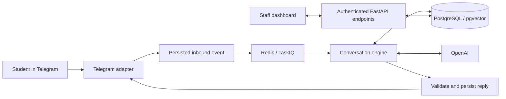

# AdmitFlow specification

Scope approved by the user; implementation progress is tracked in tasks/todo.md.
The active roadmap is [tasks/plan.md](tasks/plan.md), and implementation acceptance
lives in [tasks/todo.md](tasks/todo.md). Architecture changes are recorded in
[ADR-012](docs/decisions/ADR-012-telegram-openai-mvp.md).

## 1. Product and first release

AdmitFlow helps institutions manage admissions inquiries. Students explore courses,
ask questions and share relevant information through Telegram. Staff receive a
persisted inquiry with conversation context and a code-evaluated eligibility result.
Institutions are the proposed paying customers; revenue and adoption are unvalidated.

The first release succeeds when a real Telegram student conversation produces a
correct, persisted inquiry that authorized staff can inspect in the dashboard.
Use a fictional institution and synthetic student/catalog data for the event.
One institution is demonstrated first; tenant isolation remains mandatory.

### Included in the first release

- Telegram private-chat onboarding and language preference.
- Active course and batch exploration/selection with buttons.
- Short, context-aware eligibility questions with typed extraction and code-owned rules.
- Persistent conversation memory, corrections and continuity after restart.
- Institution FAQ answers from approved knowledge, internal source references and honest abstention.
- Adaptive English course guidance using explicit interests/background, contextual questions,
  optional deeper exploration and honest catalog/eligibility boundaries (Task 61).
- Persisted lead, conversation, facts, selected course/batch and eligibility evidence.
- Staff login, tenant-scoped lead list/detail, conversation history and human-request queue.
- Input/retrieval/output checks, duplicate/concurrency handling, clear failure states,
  privacy controls and basic sanitized operational telemetry.

### Later product phases

Application collection/review, Razorpay payments and discounts, chat takeover and
co-pilot suggestions, consent-aware follow-ups, course/rule/document management,
analytics, exports, outbound integrations, notifications, institution settings and
production operations remain on the roadmap. The decision layer uses typed OpenAI
outputs with no fine-tuning or self-hosted model. OpenAI passage reranking is required
in the current release: rank approved tenant candidates before FAQ quotation and
staff-search selection, preserving relevance thresholds and safe baseline fallback.

## 2. Stack and architecture

| Layer | Decision |
| --- | --- |
| Student interface | Telegram Bot API; private chats for the first release |
| API/domain logic | Existing Python >=3.12, FastAPI, Pydantic and uv project |
| Conversation engine | Hand-rolled async dispatcher; persistent state reloaded each turn |
| Database | PostgreSQL, SQLAlchemy async, Alembic; pgvector in the same database |
| Queue/coordination | TaskIQ + Redis; interactive jobs and a separate serial knowledge worker, scoped dedup and locks |
| Document parsing | Offline CPU Docling layout/tables for digital PDFs, ordered DOCX blocks and Markdown section/table-aware chunks; no OCR |
| AI | OpenAI for interpretation, typed extraction, grounded replies and embeddings |
| AI wrapper | Retain the existing wrapper initially, configure OpenAI only; SDK migration is unnecessary for this milestone |
| Staff UI | Next.js and TypeScript; plain CSS for the initial knowledge workspace; business rules and authorization stay in Python |
| Local runtime | Docker-backed PostgreSQL/Redis, API, receiver/worker and later the frontend |
| Monitoring | Correlated sanitized logs, model/usage/latency/error evidence; external vendors optional |
| Hosting | Select during release planning; earlier Fly.io/Vercel/Neon choices are candidates, not deployed facts |

No Neysa, SerpAPI, Gemini, Anthropic, self-hosted decision models, LangGraph or separate vector
database is required. No extra service is added merely to use sponsor credits.
Model identifiers live in configuration; selecting OpenAI does not establish access,
output-schema compatibility, quota, language quality or latency for a particular model.

## 3. Telegram identity and transport

- Provision one bot per institution for the first version. Trusted server-side bot
  configuration resolves the tenant; client payloads cannot choose another tenant.
- Identify a student using a tenant/bot-scoped Telegram user identifier. Track chat
  routing separately. A Telegram identifier or username is not a verified phone number.
- Add channel identities instead of putting Telegram IDs into phone fields. Existing
  WhatsApp rows/history remain intact. Contact phone is optional and explicitly supplied.
- Protect routing identifiers and personal information; use scoped keyed lookup values
  where practical, ciphertext for recoverable sensitive values, and stable internal IDs.
- Normalize `/start`, text and course/batch callbacks into typed engine events. Handle
  unsupported media and group/channel messages explicitly without accidental escalation.
- Choose long polling for the initial local/event receiver, with one active receiver
  per bot. Persist accepted events before advancing the offset; recover unpublished
  pending events after queue failures/restarts. Polling and webhooks cannot run together.
- Hosted webhooks are a later transport option requiring HTTPS, secret-token checking,
  validation and durable acceptance before success. An HTTP 200 is not delivery evidence.
- Dedup updates by bot/update ID; scope message IDs by bot/chat. Serialize a conversation
  with a tenant/channel/bot/chat lock. Do not use usernames as stable identity keys.
- Acknowledge button callbacks promptly, validate actor/chat/tenant ownership and current
  course availability, and handle stale/forged buttons without changing another lead.
- Sanitize logging around Telegram URLs, which contain the bot token. Store tokens only
  in ignored local configuration or a deployment secret store.

## 4. Student journey and business behavior

### Onboarding and language

`/start` introduces the institution and purpose in English, labels synthetic demo use,
and opens course exploration or resumes an active application draft. Language selection
is deferred under the current owner decision; no compulsory language menu is shown.
English, Hindi, Hinglish and Malayalam remain intended languages. Verify each supported
language before advertising it; fluent-speaker review is required for language-quality
claims. Preference storage alone is not proof of a localized or fluent experience.

### Conversation continuity and collection (Task 62)

A confirmed course/intake and verified entry rules start an application draft without
an extra application menu. Reuse explicit validated details, ask only for missing fields,
and accept multiple details/corrections in a message. Do not turn greetings, questions,
refusals or acknowledgments into form values. A birthdate is never inferred from age.
Submission always requires a final review and explicit confirmation.

Students can pause with `/pause`, resume with `/apply`, and explicitly discard an
unfinished draft with `/cancel`. Questions and further course exploration can interrupt
collection. Repeated prompts omit storage implementation details and cancellation menus.

`/reset` requires a signed one-use confirmation, clears chat profile/facts/draft, and
excludes earlier history from future model context. It preserves submitted applications,
payments, institution contact records, reminder preferences and staff/safety ownership.
It is not application deletion or a way around submitted-case review controls.

While a reply is generated, Telegram shows best-effort typing with bounded attempts and
cleanup on completion/failure. Simple greetings/form answers and a number answering the
displayed eligibility field use code directly. Free-form guidance retains typed OpenAI
interpretation and refreshed code-owned catalog checks. Model history is bounded and
loaded in bulk, with tenant-scoped callback labels rather than raw signed payloads.

### Discovery and selection

Only active institution courses with an available active batch are selectable. Present
course details from configured catalog facts. Persist valid course and batch selection,
including the case of multiple batches; do not silently select an arbitrary batch.
Changing course invalidates the old result and recomputes applicable eligibility.
Capacity is informational here; the inquiry flow does not reserve or sell a seat.

### Qualification

Use configured required fields, field types and operators. Ask one relevant missing
question at a time and use the active question/state when interpreting short replies.
Extract only explicitly supplied facts through typed schemas; validate values before
storing/evaluating them. Refusal, invalid values and missing information are explicit
outcomes, not eligibility approval. Accept corrections to existing facts and re-evaluate.
No configured rule must not automatically mean eligible unless an explicit institution
policy permits it. Do not swallow invalid transitions and still announce success.

Distinguish `eligible`, `not eligible`, `needs information` and `needs staff review`.
Persist the applicable rules, facts and reason for the current result. Eligibility is
not admission, seat reservation or enrollment. AI cannot override a failed rule.

### Memory

Store inbound and outbound turns with event/channel IDs and processing/send status.
Load the latest relevant turns in chronological presentation order, rather than the
oldest limited set. Store approved facts and preferences durably. Corrections replace
current facts with an audit trail; preserve the conversation evidence that explains them.
Restarting a process or changing a preference must not create a duplicate lead or lose
progress. Later rolling summaries must preserve corrections and material facts.

### Institution knowledge

The first release includes an authenticated institution knowledge workspace. Institution
administrators upload digital PDFs, DOCX and UTF-8 TXT/Markdown/CSV, individually or
through folder selection. Preserve nested relative paths. PDFs may contain at most
100 pages; scanned/blank pages require a searchable replacement (OCR is outside scope).
Do not promise preservation of complex visual layouts or semantic table reconstruction.

Default limits: 10 MiB per file, 30 MiB/25 files per request, 400,000 extracted characters,
and 180 seconds per indexing attempt. Validate DOCX archive expansion before parsing.
Encrypt original bytes and store durable queued/processing/ready/failed jobs; failures
are visible and retryable. Deduplicate identical bytes per institution. A worker claims
each attempt atomically, publishes all chunks together and recovers abandoned leases.
Deleting an upload removes its chunks and prevents later worker publication. Only
ready uploads appear in the workspace search. Source paths and passage numbers
accompany results; a configurable similarity floor permits an empty result. This is
document search. The Telegram journey can return a validated exact quotation with
internal evidence after the relevance and support checks. Student-facing Telegram
answers contain the quotation only, without a source filename or citation footer.
Document/chunk identifiers, source path and passage number remain in the encrypted
saved reply for internal traceability; staff document search retains its source display.
Complex parsing and
multilingual retrieval evaluation remain in Task 42/52.

Only administrators mutate documents; active staff may view/search their own institution.
Derive tenant scope from a hashed, expiring server-side session token in an HttpOnly,
SameSite cookie. Require a custom mutation header and allowlisted browser origins.
Limit sign-ins by account and connecting host; limit uploads/retries and searches per
institution. Production rate limits require shared Redis and fail closed if unavailable.
Extracted reference text and embeddings reside in the institution-scoped database;
upload only approved institution material, never applicant personal documents here.

Record source title/URL or synthetic identifier, review date and provenance/license.
Tenant-filter retrieval. Check relevance/sufficiency on an evaluation set; returning
top-k chunks alone is not a confidence gate. Abstain when the answer is absent or weak.
Retain internal source references for factual answers without appending them to
student messages. Fees/course availability come from the
structured catalog; document conflicts require staff clarification, not an invented value.
Treat document content as untrusted data, never instructions. Test multilingual retrieval.

## 5. Staff journey

Manually provision institution staff for the first release. Provide email/password
login using the standard library's scrypt password hashing, expiring server-validated sessions,
logout, secure cookie/CSRF controls where applicable, and throttled failed logins.
The authenticated session determines tenant and permissions; never trust a requested
tenant ID alone. Keep demo access limited to synthetic data.

Required screens: login; lead list with course/status filters; lead detail with facts,
eligibility evidence and ordered conversation; human-request queue and request detail.
Show loading, empty, unauthorized and error states. Manual refresh or bounded polling
is adequate; WebSockets and elaborate charts are later work. Use clear accessible
layouts; no mandatory decorative theme is part of feature acceptance.

A human request must create a durable request with the student's context. Confirm only
that the request was recorded; do not promise an unconfigured counselor response time.
Staff can acknowledge/resolve it with an audit trail. A request suppresses automatic
qualification progression; subsequent student messages remain visible and receive an
honest acknowledgment. Staff can explicitly resume the automated journey. Staff-authored
Telegram replies, live takeover and AI co-pilot suggestions are separate later features.

## 6. Safety, privacy and reliability

- Code owns eligibility, catalog facts, prices and consequential state transitions.
- All reply paths pass output checks before sending. Store validation outcome and final
  content; do not treat an LLM classifier alone as a guarantee against fabricated facts.
- Use parameterized tenant-scoped queries and test negative access across two tenants.
- Minimize collected information. Encrypt sensitive name/contact/message/fact fields at
  application level; audit authorized access and significant state/request changes.
- Never log secrets, raw bot-token URLs, raw applicant content or credentials. Telemetry
  records internal IDs, model role, timing, usage and sanitized error classifications.
- Use bounded provider/network retries and deadlines. On outage, preserve state and give
  a safe retry response; do not switch to an unconfigured AI provider.
- Persist inbound processing and outbound send outcomes. Recover pending work. Telegram
  send/network timeouts can make delivery uncertain; record that state and avoid blind
  resend loops. Do not claim exactly-once external delivery.
- Lock ownership and retry handling must not double-apply transitions. Acknowledge source
  updates only after a durable intake record; retries can safely recover remaining work.
- Remove public debug exposure before deployment. Separate health/liveness from readiness.
- Event demos use synthetic data. Before a real applicant pilot, verify privacy access,
  deletion/retention, backups, security and operating procedures; do not claim statutory
  compliance from this specification or encryption utilities alone.

## 7. Verification and release acceptance

Use pragmatic TDD for identity, rules, state, dedup, privacy and authorization. Automated
tests use fake provider/Telegram calls. Relevant integration checks use real pgvector
PostgreSQL and Redis, including migration up/down and recovery. Run the existing backend
gate, plus frontend lint/type/build and applicable UI tests once the frontend exists.
Live checks are separate, bounded and recorded with sanitized evidence and usage limits.

- [x] A real Telegram user starts a private conversation and receives a reply.
- [x] Course and batch callbacks persist the correct selection and reject forged/stale input in tests.
- [x] Qualification handles missing facts, eligible/ineligible cases and corrections in database journey tests.
- [x] Recent inbound/outbound context and encrypted facts persist independently of worker lifetime.
- [x] Approved FAQs return exact source quotations and unsupported questions abstain in journey tests.
- [x] Staff authenticate and inspect the same live persisted lead, evidence and conversation.
- [x] Human requests and acknowledge/resolve/explicit-resume controls pass database journey tests.
- [x] User-sent corrections, sourced/unsupported questions and `/human` replies are
  confirmed sent; real staff browser actions persist acknowledgment, resolution with
  pause retained and explicit resume, with audit records.
- [x] Duplicate/concurrent processing and uncertain-send handling pass regression checks.
- [x] Two-tenant negative tests prove isolation across retrieval, callback and staff endpoints.
- [ ] Selected languages, provider refusal/outage handling and output checks are evaluated.
- [ ] Setup, tests, demo limitations, final build evidence and event submission assets agree.

The existing source audit is [CURRENT_STATE.md](docs/event/CURRENT_STATE.md). Historical
default tests and Meta failures are not Telegram acceptance evidence. This document
records the target. Checked items have command, database or live evidence in tasks/todo.md;
synthetic acceptance and extended handset acceptance remain distinct.

## 8. Full roadmap and remaining decisions

Later phases retain forms/review, payments/discounts, direct staff messaging/co-pilot,
follow-ups, catalog/batch/rule/document CRUD, business hours/settings, analytics/exports,
integrations/notifications, deletion/retention and robust deployment/operations.
The [archived prior specification](docs/planning/archive/2026-10-23-before-telegram-alignment/SPEC.md)
preserves all prior details; the active roadmap classifies them without claiming delivery.

Verified choices: OpenAI access/structured schemas, 1536-dimensional embeddings,
bot provisioning, manual staff provisioning and server-side sessions. Remaining owner
decisions include live operating budget, language reviewers, hosting and continuation cost.
Event unknowns: portal details, existing-work permission, surprise requirement and any
deadline updates. These are tracked tasks, not reasons to add unnecessary services.

## Adaptive course guidance (Task 61)

### Published programme references (Task 65 / ADR-016)

Publicly listed programmes support guidance without fabricated intake records.
Mark them as references with official source URLs. Keep live eligibility, fees,
capacity and application authorization unverified. Do not select an admissions
intake, collect applications or create payments for references. The dashboard and
fee replies show unknown fees as unverified. Existing configured admissions offerings
retain their behavior. The JAIN Kochi snapshot and transactional local reset follow
ADR-016; preserve access/bot configuration and prevent synthetic reseeding.

### Supportive interaction (Task 63)

Task 64 refinement: routine discovery, catalogue browsing, uncertainty and successful
entry checks offer no staff-handoff shortcut. Generated guidance answer options must
also omit staff-contact actions. Explicit student requests, safety concerns, failed
entry-rule review and changes to submitted applications retain the relevant support
path. Existing staff-owned conversations stay paused until explicitly resumed.

When paid application fees exist but the institution has no Razorpay credentials,
show the configured fee and honest online-payment unavailability. Offer no payment
creation button or payable quote, clear an obsolete quote and create no invoice.
Preserve existing receipts/invoices and zero-payable-amount handling. Razorpay test
account setup, test-card validation and live enablement remain incomplete.

Use the primary-source techniques and limits in
[the guidance research](docs/engineering/ADAPTIVE_GUIDANCE_RESEARCH.md) and ADR-015.
CIP/CASVE provides flexible decision purposes; RIASEC informs tentative activity
themes; OARS informs listening and summaries. These do not prescribe a mandatory
question order or validate the assistant as a psychometric assessment.

Learn consequential background, interests, goals and actual prerequisites adaptively.
Do not treat short answers or lack of exposure as inability. Do not demand technical
project proof. Offer contextual answer buttons when useful, uncertainty and free text;
use text for precise academic facts. Only a verified tap becomes evidence, never an
implicit course selection. Expire stale options across conversation/context resets.
Prevent repetitive discovery and unanswered-prerequisite loops. Do not recommend a
course on schooling alone or infer specific curriculum from a generic description.
No extra provider request is needed to render controls or recover from a stalled turn.

English is the active conversation language for this slice; onboarding does not require
language selection. Guide applicants toward relevant institution courses by exploring
explicit background, interests, experience, goals, values and practical constraints.
Ask one useful contextual question at a time, adapt to known answers, accept corrections
and skipped topics, and let a decided applicant proceed without a compulsory quiz.
Text is the default for reflection; signed choices are useful for real course/batch
selection and optional deeper exploration, rather than every answer.

The student's provisional exploration stage and broad interest evidence are encrypted
with conversation memory and may be reviewed by authorized staff. These are contextual
notes, not an aptitude score, diagnosis, fixed personality type or admissions criterion.
The optional deeper conversation uses original prompts; an official external interest
inventory is offered only on request. No licensed test items/scoring are copied.

Every institution recommendation uses a live tenant-owned active catalog entry with an
open batch. Exclude courses with a failed known eligibility rule; unknown requirements
remain explicitly unverified and ask only necessary questions. Code owns academic
eligibility, fees, availability and actual selection. Interest notes never grant or deny
admission. Recommendations explain student evidence, course evidence, uncertainty and
a useful next step. Offer relevant less familiar catalog courses without overriding a
student's clear preference or repeatedly upselling. When no suitable offering can be
verified, say so and offer clearly labelled fields to research elsewhere. Never invent
another institution's courses, accreditation, prerequisites, job outcomes or availability.

Preserve FAQ grounding/abstention, consent, safety/human handoff, applications/payments,
tenant boundaries and encrypted persistence. Guidance may pause/resume around FAQs or
eligibility collection. Only explicit student choices change course/batch selection;
submitted applications retain their existing change controls. Provider failures keep
profile/selection safe and offer a retry or explicit catalog browse, not an invented fit.

## Explicit local demo application mode

ADR-017 permits separately configured test applications on public-reference courses. Demo
fees are distinct from unverified university fees; no real batch, capacity or academic
eligibility is fabricated. Confirmed course choice leads to a reviewable demo application,
Razorpay test payment and staff review. Development-only institution/test-key guards and
persistent demo markers prevent this exception from enabling real admissions or payments.

The owner-selected sample fee is INR 3,000 (300,000 paise) per demo application,
separate from unverified university fees. Confirmed course choice starts a draft;
explicit review/submit and fee confirmation precede provider link creation.
Only a verified captured test payment permits demo staff approval. The local
scheduler may authenticate exact provider link/payment reads in place of public
webhook ingress for demo invoices; real payments retain signed event confirmation.
